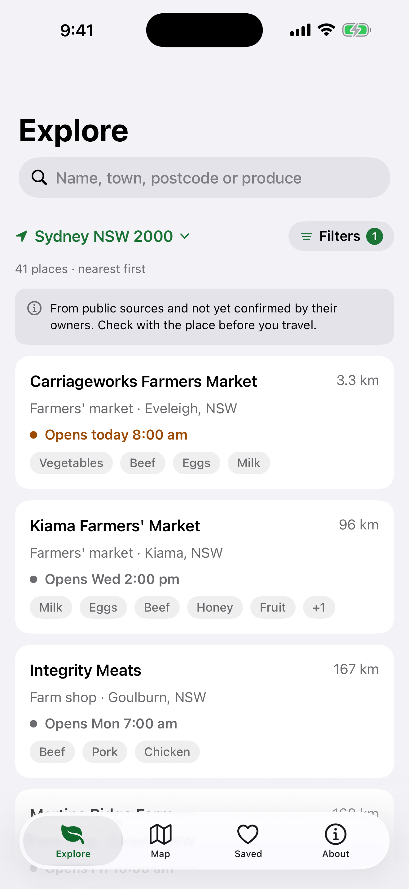

# Farm Direct meat campaign: ad kit

Five ads, two sizes each, one look. This kit gives you the tokens, the components, a working template and a renderer. Read it all once (about five minutes), then copy the template.

## Files

| File | What it is |
|---|---|
| `shared/kit.css` | Tokens (colour, type, grid) and components: `.artboard`, `.hl`, `.support`, `.label`, `.footer` + `.brand`, `.cta`, `.chip`, `.chip-bar`, `.ripple`, `.card`, `.phone`, `.art` (SVG line art), guides |
| `shared/kit.js` | Reads `?size=feed` or `?size=story`, sets the artboard class, turns on guides with `&guides=1`, and tells the renderer when fonts and images are ready |
| `shared/template.html` | Minimal working ad using every main component. Copy it to start |
| `shared/icon.png` | The app icon (1024 px). Use it only in the `.brand` lockup |
| `shared/screens/*.png` | App screenshots, 1320x2868. **Placeholders today** (see "Screens" below) |
| `render.mjs` | Renders `NN-slug/ad.html` to `out/NN-slug-feed.png` (1080x1350) and `out/NN-slug-story.png` (1080x1920) |

## Commands

Run from the repo root (`/home/user/farmappaus`) or from `marketing/ads/`; paths are resolved against the script's folder either way.

```bash
# 1. Start your ad from the template (your folder only)
mkdir -p marketing/ads/02-real-meat-tap
cp marketing/ads/shared/template.html marketing/ads/02-real-meat-tap/ad.html

# 2. Render your ad, both sizes
node marketing/ads/render.mjs 02-real-meat-tap

# one size only, while iterating
node marketing/ads/render.mjs 02-real-meat-tap --size story

# the template itself (writes out/template-feed.png and out/template-story.png)
node marketing/ads/render.mjs shared/template.html

# every NN-slug folder that has an ad.html (the orchestrator's final run)
node marketing/ads/render.mjs
```

Output: one line per PNG with its path and pixel size, for example
`wrote /home/user/farmappaus/marketing/ads/out/02-real-meat-tap-feed.png 1080x1350`, followed by any `WARN` lines. The script exits non-zero if a render fails or a PNG has the wrong size.

Then **look at both PNGs** (Read tool on the PNG) before you call the ad done. Shrink it in your head to phone size: a feed ad is seen about 375 px wide, so 34 px type becomes about 12 px.

To check placement by eye, open `ad.html?size=story&guides=1` in a browser (pink = margins and story no-go zones, dashed blue = feed footer band). Guides never appear in renders unless you pass `guides=1`.

Parallel runs are safe: each run starts its own browser and writes to a temporary file that is renamed into place, and each ad writes only its own two files. Name your ad only; do not run the no-argument form while others are working (it re-renders everyone's ads, harmlessly but slowly).

### What the WARN lines mean

The renderer lints every text node inside `.artboard`:

- text outside x 80..1000 (the 80 px margins);
- story: text outside y 250..1580 (feed: outside the artboard);
- any text under 34 px;
- a font that is not Inter or Inter Display (a fallback font means a typo in `font-family` or weight);
- images that failed to load, page errors;
- a screenshot that is byte-identical to another screen (a placeholder).

Fix every WARN except the placeholder one. If something is deliberately outside a zone (it should not be text), put `data-lint-ignore` on it and say why in an HTML comment.

## Starting an ad

```html
<link rel="stylesheet" href="../shared/kit.css">
...
<div class="artboard feed bg-green">      <!-- kit.js swaps feed/story from the URL -->
  ...your layout, absolutely positioned in artboard pixels...
  <div class="footer"> ...brand lockup (copy it from the template)... </div>
</div>
<script src="../shared/kit.js"></script>  <!-- last thing in <body> -->
```

- Position things with `position:absolute; left/top` in artboard pixels. Write the feed value, then override it under `.story` (see the template's `<style>`). The artboard is 1080 wide with `padding: 0 80px`.
- Keep relative paths `../shared/...` so the file works from your folder.
- No external URLs (no Google Fonts, no CDNs): Inter and Inter Display are installed and declared in the kit.

## Palette (family rules)

| Token | Hex | Use |
|---|---|---|
| `--green` | #1B7335 | Deep green. Primary; the app accent. Ground for ads 1, 3 (lower block), 4 (top) |
| `--forest` | #0F3D1D | Dark forest. Darkest ground, **ad 5 only** |
| `--sprout` | #CDE8C4 | Pale sprout. Second-tone type and line art on green or forest |
| `--offwhite` | #F7F5EF | Warm off-white. Light ground (ads 3, 4) and type on green |
| `--grey-bg` | #F2F2F7 | App pale grey. **Ad 2** ground |
| `--white` | #FFFFFF | Cards, tiles, chips |
| `--ink` / `--ink-2` | #111111 / #1C1C1E | Type on light; phone border on light |
| `--ink-sub` | #3C3C43 | Support lines on light |
| `--gold` | #E9B44C | Wattle gold. **Exactly one small mark per ad** (a sun, a fingertip dot, a cursor, a pin centre). Never type, never a ground |

Grounds by ad: 1 full deep green; 2 pale grey; 3 off-white over a deep green block; 4 deep green top over off-white; 5 dark forest.

Ground classes set the background and the type colours together: `.bg-green`, `.bg-forest`, `.bg-offwhite`, `.bg-grey`. For type or a footer sitting on a colour block (not the artboard ground), add `.on-dark` or `.on-light` to that element. Colours used by `.hl .alt`, `.support`, `.brand__cta` and the icon hairline all follow these classes.

Sampled from the icon (tokens `--icon-*`, reference only): ground #3E5C2A, disc #4C6F35, sprout cream #F7F1E5, right leaf gold #E3BC62. The icon is olive, the campaign green is the app's #1B7335; they sit together fine because the icon is small and framed. The icon's own gold leaf does not count as the ad's warm mark, but do not put your gold mark right next to the icon.

## Type

Inter Display for headlines, Inter for everything else. Australian English, sentence case (only ad 3's small meat row is letter-spaced capitals). **Nothing under 34 px anywhere.**

| Class | Font | Feed size | Notes |
|---|---|---|---|
| `.hl` + `.hl-96` ... `.hl-200` | Inter Display Black 900 | 96, 104, 112, 120, 140, 150, 190, 200 | line-height 0.96, tracking -0.02em. Family range 104-150 (ad 1's big word up to 190) |
| `.hl .line` | | | one `<span class="line">` per line; lines never wrap, so you control the break |
| `.hl .alt` | | | second tone: sprout on green/forest, deep green on light |
| `.hl .big` | | 1.3x | emphasised word (ad 1's "paddock,") |
| `.support` (+ `.support-42`, `-48`, `-56`, `.semibold`) | Inter Medium 500 (or 600) | 44 (42-56) | line-height 1.2, max two lines, balanced wrap |
| `.label` (+ `.label-34`, `-40`), `.caps` | Inter Semibold 600 | 36 (34-40) | chips, labels; `.caps` adds uppercase + 0.04em |
| `.brand__name` | Inter Bold 700 | 40 | footer wordmark |
| `.brand__cta` | Inter Regular 400 | 34 | footer CTA "Free for iPhone" |

Story automatically scales every `.hl-*` and `.support*` size by 1.1 (`--s`). Check that your longest headline line still fits 920 px in story: the renderer warns if it does not.

## Grid

- 80 px side margins, 920 px live width.
- **Feed** 1080x1350: headline in the top third or top half; one focal device; footer band y 1180..1292.
- **Story** 1080x1920: everything that matters between y 250 and y 1580. Above 250 and below 1580 only flat colour or decorative bleed (a cropped phone). Default story footer: y 1448..1560. Change it per ad with `--footer-top` on the artboard, for example `.story { --footer-top: 1440px; }`.
- Variables on the artboard for your own maths: `--safe-top`, `--safe-bottom`, `--footer-top`, `--margin`.

## Components

### Footer band (identical in all five; copy exactly)

```html
<div class="footer">
  <div class="brand">
    
    <div class="brand__text">
      <span class="brand__name">Farm Direct</span>
      <span class="brand__cta">Free for iPhone</span>
    </div>
  </div>
</div>
```

Icon 112 px, 25 px corner radius, 24 px gap, hairline `rgba(0,0,0,.08)` on light grounds (automatic). Off-white type on green and dark grounds; near-black wordmark and deep green CTA on light grounds (automatic from the ground class; add `.on-dark`/`.on-light` to `.footer` if it sits on a different block, as in ad 3). Nothing else in the footer: no App Store badge, no Apple logo, no device.

### Phone outline (ads 2 and 5 only)

```html
<div class="phone crop no-status" style="--w:560px; --h:700px; right:60px; top:560px">
  
</div>
```

- Plain CSS rounded rectangle: 56 px radius, 14 px border, no notch, island, camera or buttons.
- `--w` screen width in px (the frame adds 28). `--h` visible screen height: leave it out for the whole screen, or set it to crop at the **frame's bottom edge** only (add `.crop` to square off the screen's lower corners). Frame height = `--h` + 28. The top of the screen always shows.
- `.no-status` hides the screenshot's own status bar strip (the clock and the black camera cut-out drawn into the screenshot), so the outline never reads as a particular phone. **Use it on every phone.** It is the only top crop allowed.
- `.frame-light`: off-white border and a deeper shadow for dark grounds (ad 5). Default border is #1C1C1E for light grounds.
- `.tilt-r` / `.tilt-l`: 4 degrees (rotates around the top centre). Or set `--tilt`.
- Size shortcuts: `.w-540`, `.w-560`, `.w-600`, `.w-620`.
- The phone sits at `z-index: 2`. Default shadow `0 24px 60px rgba(0,0,0,.12)`.
- Story: the phone may run past y 1580 as decoration, but nothing that carries the message may be below 1580.

### Chip, chip bar, ripple (ads 2 and 4)

```html
<div class="ripple" style="position:absolute; left:146px; top:790px">
  <span class="chip chip-xl">Meat</span>
  <span class="dot-gold" style="right:26px; top:calc(50% - 14px)"></span>
</div>

<div class="chip-bar"><span class="chip">Meat</span><span class="chip">This weekend</span></div>
```

`.chip` copies the app's selected filter chip (deep green, white Inter Semibold 40). `.chip-xl` is the oversized focal version (160 px tall, 92 px type). `.chip.off` is an unselected chip. `.ripple` draws two concentric rings (35% and 12%) around its content; its rings pass under a phone and its content sits over it. Do not give the `.ripple` wrapper a z-index or transform. `.dot-gold` is a 28 px wattle-gold dot.

### CTA pill

`<span class="cta">Free on the App Store</span>` (also `.cta.light`, `.cta.outline`). Plain text only. The family footer already carries the CTA, so most ads will not need it.

### Card / tile

`.card`: white, 28 px radius, soft shadow, clips its content (ad 4's calendar tiles).

### Line art (SVG you draw yourself)

```html
<svg class="art" width="920" height="200" viewBox="0 0 920 200" style="color: var(--sprout)">
  <path class="ln" d="M0 150 C 200 110, 420 110, 920 140"/>
  <path class="ln gold" d="..."/>     <!-- the ad's one warm mark -->
</svg>
```

`.ln` = no fill, `currentColor` stroke, 6 px (`--stroke`), round caps and joins. Strokes do not scale with the viewBox (`vector-effect: non-scaling-stroke`), so 6 px stays 6 px. 5 px minimum. Fills only where the brief specifies (`.gold-fill`).

## Screens: placeholders today

Every file in `shared/screens/` is 1320x2868. Today 02 to 06 are copies of 01, and 01 currently shows **one named place page**, not a list. The orchestrator will swap in the real screens (same names) and re-render. So:

- Reference the exact file named in your brief (`02-explore-meat.png` for ad 2, `03-map.png` for ad 5).
- The ad must read fully whatever the screen shows. Never caption, point at, crop to or rely on anything in the screenshot.
- Expect a single business name to be visible in your draft renders. That is the placeholder; do not "fix" it by masking. It goes away when the real list and map screens arrive, and the final render must be checked again then.
- The renderer prints a placeholder WARN while a screen is byte-identical to another one.

## Family rules (creative lead)

1. Grounds as listed above; one focal device per ad; the gold mark exactly once.
2. Headlines Inter Display Black, 104-150 px in feed, line-height 0.95-1.0, tracking -0.02em; story about 10% larger. Support 42-44 px, max two lines. Chips and labels 34-40 px. Nothing under 34 px.
3. 80 px margins. Feed footer at y 1180..1290. Story content between y 250 and 1580.
4. Footer identical in all five (above).
5. Phone frames only in ads 2 and 5: CSS outline, 56 px radius, 14 px border, no device details; screen scaled to fit width; cropped only by the frame's bottom edge (plus `.no-status`).
6. Line art: original SVG only, 6 px strokes, round caps and joins. No photos, no AI images, no animals, no lab, scientist or petri dish drawings, no logos or brand-like shapes.
7. Copy: numbers checked against `src/data/realListings.json` on 13 Nov 2026: 106 places; 41 list beef, lamb, pork or chicken (25 markets, 12 farm shops, 3 farms, 1 farm-gate stall; beef 28, lamb 23, pork 18, chicken 16; NSW 13, VIC 7, WA 7, SA 6, QLD 5, ACT 2, TAS 1, NT 0). Say "about 40", "nearly 30" (weekend hours), "list"/"listing" (not "stock"), "across Australia" (never "every state" for meat), "nearest" (never "any town" or a guarantee). Do not promise a Call button (only 13 of 41 have a phone).
8. No raising, quality, health, price or safety words (grass-fed, free-range, organic, hormone-free, chemical-free, healthier, cheaper, safer, better for you). "Ask the farmer" is fine.
9. Lab-grown contrast is a positioning line about Farm Direct only. No claims about supermarkets, "big food", scientists or government; no conspiracy, no scare; name or disparage no one.
10. Each positioning line in one ad only: paddock/petri dish (ad 1), "Real meat. Real farmers." (ad 2), "Meat with a postcode" (ad 3).
11. No single named business as the hero; nothing implying a place endorses or partners with Farm Direct.
12. No Apple logo, no App Store badge artwork, no picture of an Apple device. Plain text "Free for iPhone" / "Free on the App Store" is fine.

## Checklist before you hand in

- [ ] `node marketing/ads/render.mjs NN-slug` prints two files at 1080x1350 and 1080x1920, and no WARN except the placeholder one.
- [ ] Looked at both PNGs. At phone size (feed about 375 px wide) the headline reads in one glance and every line of text is legible.
- [ ] Story: nothing that matters above y 250 or below y 1580 (open with `&guides=1` to check).
- [ ] One focal point. One wattle-gold mark, not used for type.
- [ ] Footer band exactly as the kit's (icon, "Farm Direct", "Free for iPhone").
- [ ] No forbidden assets: no photos or AI images, no Apple logo, badge or device, no animals, no lab imagery, no logos, no real business as hero, nothing loaded from the internet.
- [ ] Copy uses only the verified numbers and words above; Australian spelling; no raising, quality, health, price or safety claims.
- [ ] The ad still works if the screenshot shows any list or map.
- [ ] You created or edited files only in your own `marketing/ads/NN-slug/` folder (and `out/` via the renderer). Do not edit `shared/`; ask the kit owner.
